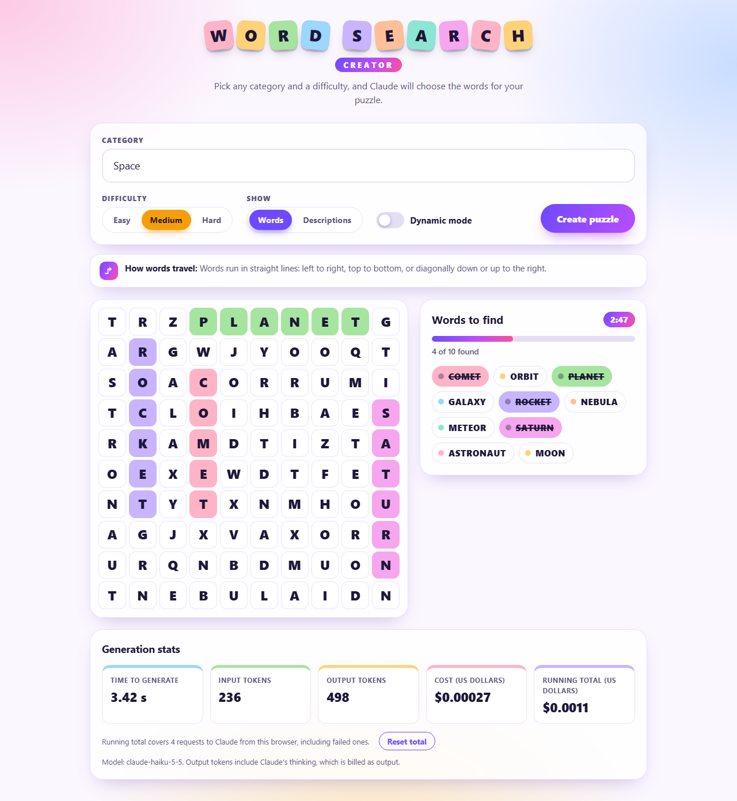
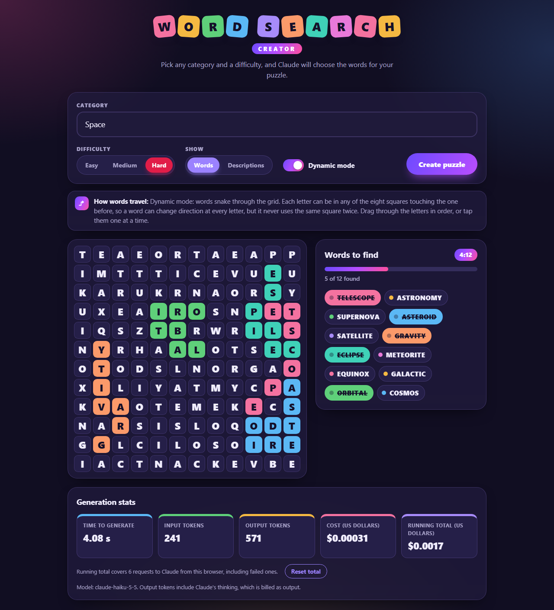
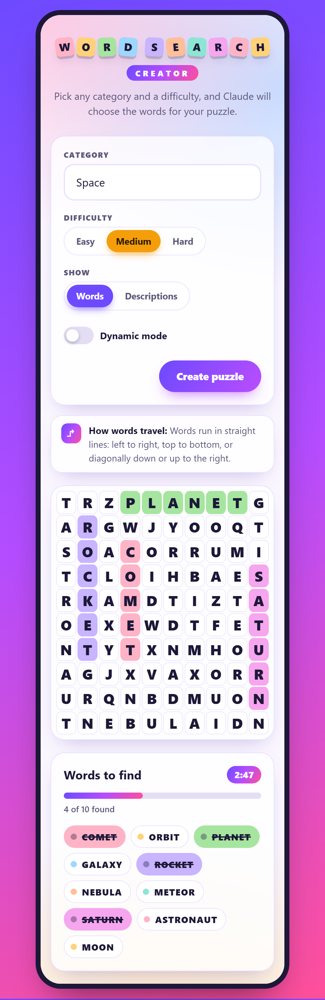

# AI Word Search Generator

A word search generator that creates a puzzle for any category. A language model chooses the words, and the grid is built according to the difficulty level selected.



I first built a word search generator by hand as my final-year project for my Computer Science degree in 2009. I rebuilt it in 2026 with Claude Code to see how much AI-assisted development has changed the way software gets built, and where it still needs a person.

## Features

- **Any category:** type a topic (e.g. "Formula 1 drivers" or "kitchen equipment") and the model generates a suitable word list.
- **Difficulty levels:** easy, medium or hard, which sets the grid size, the number of words and the directions words can run in.
- **Show words or descriptions:** play with the list of words to find, or with only their descriptions as clues.
- **Family friendly:** I see this as a tool for families and children, so words and categories that aren't appropriate are refused.
- **Cost and timing:** each puzzle shows how long it took to generate, the tokens used and what it cost.
- **Dynamic mode:** words aren't limited to straight lines. On easy and medium they bend once or twice; on hard they snake through the grid and can change direction at every letter. A note on the page explains how words travel for the chosen mode and difficulty.

## Screenshots

| Dynamic mode on hard, in dark mode | On a phone |
|---|---|
|  |  |

The screenshots use sample Space puzzles built with the app's own placement code; the cost figures shown are typical values rather than from a recorded run.

## 2009 vs 2026

| | 2009 (by hand) | 2026 (Claude Code) |
|---|---|---|
| Time to build | 6 months | 2 evenings |
| Word list | Drawn from a database of words | Generated by a language model for any category |
| Categories | Limited to those in the database | Any category a user types in that is deemed appropriate |
| Grid placement | My own algorithm, written from scratch | Built with Claude Code, then reviewed and tested by me |
| Language and tools | Java and SQL Server | Python with Claude Code |
| What still needed me | Everything | Difficulty rules, validating generated words, fixing placement edge cases |

## What changed with AI

The biggest change is where the words come from. In 2009 the database guaranteed that every word was real and correctly spelt, but the puzzle could only use categories that someone had already entered. A language model removes that limit, at a cost: generated words can be misspelt, off-topic, too long for the grid, or repeated.

To deal with that, the app:
- asks for the word list as structured JSON, so the reply always has the expected shape
- rejects words with spaces, hyphens or other characters outside A–Z
- rejects words that are too short or longer than the grid allows
- removes duplicates and words without a description
- only returns words that were actually placed in the finished grid, so every puzzle is solvable
- refuses unsuitable categories, with the model flagging them and the API returning a clear error

## Where Claude Code helped, and where it didn't

**It helped with:**
- generating the grid placement logic quickly
- building the interface
- writing tests
- finding bugs

**It still needed me for:**
- checking the grid selection worked as expected
- suggesting design tweaks for a better user experience
- deciding how to handle bad words from the model

## How it works

1. The user enters a category and chooses a difficulty level.
2. The app asks Claude Haiku 5.5 for a list of words, with descriptions, matching the category.
3. The words are validated and filtered.
4. The placement algorithm fits the words into the grid using the directions allowed at that difficulty level, overlapping only where letters match.
5. The remaining cells are filled with random letters. On hard, the filler favours letters from the hidden words to create decoys.
6. Each word is located in the finished grid, and only words that can be found are sent to the page with their path of cells.

### Dynamic mode

| Difficulty | Style | Directions | Turns |
|---|---|---|---|
| Easy | Bends | right, down | exactly 1 |
| Medium | Bends | right, down, diagonally down or up to the right | 1 or 2 |
| Hard | Snake | any of the eight neighbouring squares | at least 1, up to every letter |

With bends, each straight part is at least 3 letters long so the turn is easy to see, which means words shorter than 5 letters stay straight. No word ever uses the same square twice.

Placement is a depth-first search with backtracking: from a random start, it tries the allowed directions in random order, backs up when it gets stuck, and gives up after a fixed number of steps so a crowded grid can't stall a request. On the page, the player drags through the letters or taps them one at a time, and the selection counts when it follows the word's path from either end. While dragging, a square only registers once the pointer is near its centre, so cutting across a corner doesn't pick up a diagonal neighbour by mistake.

The model only chooses the words; all grid logic is plain Python, so it is deterministic and unit-tested.

## Project structure

```
src/wordsearch/
├── api.py          # FastAPI app: POST /api/puzzle and the web page
├── generate.py     # Claude call for the word list, then builds the puzzle
├── validate.py     # cleans and filters the generated words
├── grid.py         # straight-line word placement and filler letters
├── paths.py        # dynamic mode placement along bending paths
├── dynamic.py      # builds dynamic mode puzzles
├── directions.py   # the eight directions and which each difficulty allows
├── config.py       # model, grid sizes, pricing; loads .env
└── __main__.py     # `python -m wordsearch` starts the server
web/index.html      # the front end (HTML, CSS and JavaScript in one file)
tests/              # pytest suite; Claude is faked, so no API key or cost
scripts/            # check_api.py: checks your API key works
docs/screenshots/   # images used in this README
notebooks/          # prompt experiments
```

## Running it locally

Requires Python 3.10+ and an [Anthropic API key](https://console.anthropic.com/).

```bash
git clone https://github.com/ranveer-singh-10/ai_word_search_creator.git
cd ai_word_search_creator
python -m venv .venv
source .venv/bin/activate          # Windows: .\.venv\Scripts\Activate.ps1
pip install -e ".[dev]"
cp .env.example .env               # add your own API key
wordsearch                         # or: python -m wordsearch --reload
```

Then open http://127.0.0.1:8000.

API keys are read from `.env`, which is excluded from the repository.

## Tests

```bash
pytest
```

The tests cover word validation, straight and dynamic placement rules, the Claude call and the API end to end. Claude is replaced by a fake client, so they run offline in under a second.

## Cost

Each puzzle makes one model call. At current pricing for Claude Haiku 5.5, that is roughly $0.00018–$0.00031 per puzzle depending on difficulty and category.

## What I learned

- AI tools are fast at the parts I found hardest in 2009, such as placement and backtracking
- generating the content created new problems that a fixed database never had
- the time saved went into testing and design decisions rather than writing code

## Possible next steps

- check words against a dictionary
- ask the model for replacements when too many words are rejected
- multiple languages
- themed puzzles for schools
- print-friendly option for children
- comparing word quality across models with my model evaluation tool

## Licence

MIT. See [LICENSE](LICENSE).
